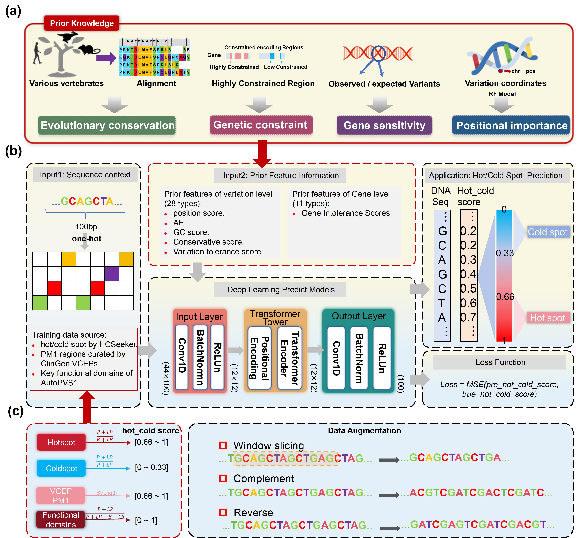

# HCSeeker2
Deep learning integration of sequence context and prior features for whole-exome variant hot and cold spot prediction
<div align="center">
  
</div>


## Prerequisites
To run this project, you need the following prerequisites:
- Python 3.9
- PyTorch 1.13.1+cu117
- Other required Python libraries (please refer to requirements.txt)

You can install all the required packages using the following command:
```
conda create -n pytorch python=3.9.16
conda activate pytorch
```
```python
pip install torch==1.13.1+cu117 torchvision==0.14.1+cu117 torchaudio==0.13.1 --extra-index-url https://download.pytorch.org/whl/cu117
```
```python
pip install -r requirements.txt 
```
or
```python
conda env create -f HCSeeker2.yaml
```

## Model Training
To train the Translatomer model, use the following command, training data was obtained from Zenodo([https://zenodo.org/uploads/17949354](https://zenodo.org/records/17949354)):
```
python HCSeeker2_train_predict.py [options]

[options]:
- --run_type  run type. Default = 'train'.
- --seed  Random seed for training. Default value: 42.
- --save_path  Path to the model checkpoint. Default = 'checkpoints'.
- --assembly  Genome assembly for training data. Default = 'hg38'.
- --model-type  Type of the model to use for training. Default = 'TransModel'.
```
Example to run the codes:
```
python HCSeeker2_train_predict.py --run_type train --sequence_data "\path\Train_input_seq_100bp.txt" --input_feature_data "\path\Train_input_feature_100bp.txt"  --output_feature_data "\path\Train_output_hot_cold_score_100bp.txt" 
```

```
python HCSeeker2_train_predict.py --run_type predict --sequence_data "\data\predict_data_chrY_seq.txt" --input_feature_data "\data\predict_data_chrY_feature.txt" --checkpoint "\path\to\your\Model.ckpt" --predict_result_path "\path\predict_result\predict_result_chrY.txt" 
```

